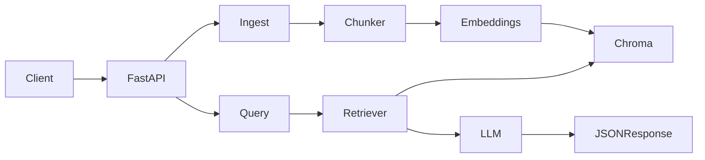

# Design: doc-qa-api

Hard constraints: [PROJECT_RULES.md](PROJECT_RULES.md).

## Problem

Operators need a small local REST API that ingests technical documentation (PDF, Markdown, plain text) and answers questions using only those documents. Responses are structured JSON with citations so callers can show sources.

## Non-goals (v1)

- UI or streaming responses
- Authentication, multi-tenancy, or rate limiting
- Managed or hosted vector databases, and deployment infrastructure (TLS, gateway, orchestration). Docker packaging is allowed; deployment itself is a later stage
- Framework-level RAG pipelines (LangChain, LlamaIndex). Individual maintained libraries are used where they replace hand-written code (see [ADR-0002](docs/adr/0002-relax-dependency-and-infrastructure-rules.md))
- Re-ingest/versioning, OCR, or additional file types (HTML, DOCX)

## Components



| Layer | Path | Responsibility |
| --- | --- | --- |
| HTTP | `app/api/` | Parse requests, call use-cases, return Pydantic models |
| RAG | `app/rag/` | Load, chunk, embed, retrieve, prompt, generate |
| Storage | `app/storage/` | Persist and query chunks (`VectorStore`: add, query, list, delete, `ping` for readiness, `close`); Chroma is hidden behind this |

`app/config.py` holds model names (`gpt-4o-mini`, `text-embedding-3-small`), chunk sizes, and paths.

## Application lifecycle

`create_app` reads `Settings` and registers a FastAPI `lifespan` ([ADR-0004](docs/adr/0004-config-lifespan-and-health.md)). On startup the lifespan builds the vector store and OpenAI client and publishes them as `app.state.services`; on shutdown it closes the OpenAI client and the vector store (`VectorStore.close()`) and removes the services, even if the app stops with an error. Tests inject fakes through `create_app(...)`; the app takes ownership of an injected store and closes it too. Services exist only while the app is running, so tests use `with TestClient(app)`.

## Request lifecycle

**Ingest (`POST /documents`)**

1. Validate **every** file before storing anything: allowed extension, size under the limit, readable PDF, non-empty text. One bad file rejects the whole request (HTTP 400) and nothing is stored.
2. Split text into overlapping chunks.
3. Embed chunks with OpenAI `text-embedding-3-small` (batched, 100 inputs per request).
4. Upsert vectors and metadata (`document_id`, `filename`) into persistent Chroma at `data/chroma/`.
5. Return document ids and chunk counts.

Every request gets a correlation ID (`asgi-correlation-id` middleware): an inbound `X-Request-ID` UUID is kept, otherwise one is generated, and it is returned in the `X-Request-ID` response header. A structlog processor adds it as `request_id` to every log record written while the request is handled, including uvicorn's access line ([ADR-0005](docs/adr/0005-observability-stack.md)).

Routes are synchronous (`def`), so FastAPI runs the blocking OpenAI/Chroma calls in its threadpool instead of the event loop. Domain errors are mapped to HTTP in one place (`app/api/errors.py`): `DocumentRejectedError` to 400, and OpenAI errors by type ([ADR-0006](docs/adr/0006-openai-error-mapping.md)): rate limit 503 with `Retry-After`, credential errors 503, timeout 504, anything else 502. The OpenAI client has a configurable timeout and uses the SDK's built-in retries.

**Query (`POST /query`)**

1. Embed the question.
2. Retrieve `top_k` nearest chunks.
3. If none, return HTTP 200 with a grounded “not enough context” `answer` and empty `sources`.
4. Otherwise call `gpt-4o-mini` with retrieved snippets and return the answer plus sources.

## Chunking

- Approximate token length as 4 characters per token.
- Target chunk size **800 tokens**, overlap **150 tokens**.
- Prefer breaking on Markdown headings (`#{1,6} `) and blank lines; fall back to a character window if a unit is still too large.

## Prompt contract

The model must:

- Answer only from the provided snippets.
- Say it does not have enough information when the snippets do not support an answer.
- Not invent APIs, versions, or file names.

The API always attaches `sources` from retrieval (not from the model’s prose).

## REST contract

| Method | Path | Success | Errors |
| --- | --- | --- | --- |
| `GET` | `/health/live` (alias `/health`) | `200` `{ "status": "ok" }`; never checks dependencies | — |
| `GET` | `/health/ready` | `200` `{ "status": "ready", "reasons": [] }` | `503` `{ "status": "not_ready", "reasons": [...] }` when the API key is missing or the vector store does not answer a ping |
| `POST` | `/documents` | `200` ingest summary | `400` unsupported type, empty, or too large; `502`/`503`/`504` OpenAI failure (see failure modes) |
| `GET` | `/documents` | `200` list of `{ document_id, filename, chunk_count }` | — |
| `DELETE` | `/documents/{document_id}` | `204` | `404` unknown id |
| `POST` | `/query` | `200` answer JSON | `422` validation; `502`/`503`/`504` OpenAI failure (see failure modes) |

**Query request**

```json
{ "question": "How do I create a widget?", "top_k": 5 }
```

**Query response**

```json
{
  "answer": "Use POST /widgets to create a widget.",
  "sources": [
    {
      "document_id": "abc123",
      "filename": "api.md",
      "snippet": "...relevant chunk...",
      "score": 0.81
    }
  ]
}
```

`score` is cosine similarity approximated as `1 - distance` from Chroma (cosine space), clamped to `[0, 1]`. Empty corpus or empty retrieval still returns `200` with a clear `answer` and `sources: []`.

## Data on disk

| Path | Contents |
| --- | --- |
| `data/chroma/` | Chroma persistent store (extracted text is stored as chunks; uploaded bytes are not kept) |

The directory is created when the app is built (`create_app`), not on import, and is gitignored.

## Observability

Decisions are in [ADR-0005](docs/adr/0005-observability-stack.md).

- **Logs** (`app/logging_config.py`): JSON, one object per line on stdout, from our code, stdlib and uvicorn alike. Fields: `timestamp` (ISO, UTC), `level`, `logger`, `event`, `request_id` (only during a request) plus event fields. Events: `app_started`, `app_stopping`, `documents_ingested` (`document_count`, `chunk_count`), `query_answered` (`top_k`, `source_count`). Uvicorn's access line is its own message (client, request line, status) and carries `request_id`; latency comes from metrics. Set `LOG_JSON=false` for console output.
- **Request ID**: `X-Request-ID` is accepted (UUID, dashed or 32-hex), generated otherwise, returned on every response, and attached to every log line of that request.
- **Metrics** (`app/metrics.py`, `GET /metrics`, `METRICS_ENABLED`): `http_requests_total{handler,method,status}`, `http_request_duration_seconds{handler,method}` (buckets to 30s), `http_request_duration_highr_seconds` (all routes, fine buckets), request/response size summaries, and runtime metrics (`python_gc_*`, `python_info`, plus `process_*` CPU, memory and file descriptors on Linux). `handler` is the route template; health probes and `/metrics` are not counted. Counters are per instance.
- **Never logged**: API keys, file contents, filenames, questions. Exception tracebacks keep file, line and function but never local variable values. `tests/test_logging.py` checks this on an ingest and query run.

## Failure modes

Error bodies are `ErrorResponse` (`detail`, `request_id`); `request_id` matches the `X-Request-ID` header. FastAPI's 422 validation body is unchanged.

| Situation | Behavior |
| --- | --- |
| Unsupported extension | `400` |
| Empty extractable text | `400` |
| Corrupt / unreadable PDF | `400` |
| File over size limit (10 MiB) | `400` |
| No documents / no hits | `200` + empty sources |
| Unknown `document_id` on delete | `404` |
| OpenAI rate limit (after SDK retries) | `503` + `Retry-After` |
| OpenAI rejects our API key or permissions | `503` "Upstream service is misconfigured" (logged at error level) |
| OpenAI timeout (after SDK retries) | `504` |
| Other OpenAI error (connection, 4xx, 5xx) | `502` |
| Any unexpected exception | `500` `"Internal server error"`; traceback (no locals) only in logs |
| Missing `OPENAI_API_KEY` at runtime | `503` on ingest/query; `/health/ready` reports not ready, `/health/live` stays `200` |

## Security (v1)

- Local, unauthenticated. Do not expose this process on a public network.
- Do not log file contents, questions, or the API key (checked by tests).
- `/metrics` is unauthenticated like the rest of the API; keep it on a private network.
- Reject unexpected MIME/extensions; cap upload size.

## Future work

- Additional file types, OCR, and re-ingest
- Hybrid search and reranking
- Authentication, rate limiting, deployment, and a managed or highly available vector store
- Streaming answers
