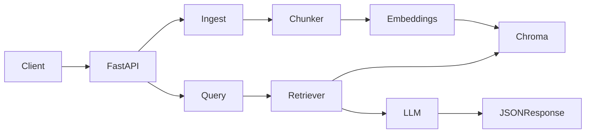

# Design: doc-qa-api

Hard constraints: [PROJECT_RULES.md](PROJECT_RULES.md).

## Problem

Operators need a small local REST API that ingests technical documentation (PDF, Markdown, plain text) and answers questions using only those documents. Responses are structured JSON with citations so callers can show sources.

## Non-goals (v1)

- UI or streaming responses
- Authentication, multi-tenancy, or rate limiting
- Docker, cloud vector databases, or extra infrastructure
- LangChain, LlamaIndex, or other orchestration frameworks
- Re-ingest/versioning, OCR, or additional file types (HTML, DOCX)

## Components



| Layer | Path | Responsibility |
| --- | --- | --- |
| HTTP | `app/api/` | Parse requests, call use-cases, return Pydantic models |
| RAG | `app/rag/` | Load, chunk, embed, retrieve, prompt, generate |
| Storage | `app/storage/` | Persist and query chunks; Chroma is hidden behind this |

`app/config.py` holds model names (`gpt-4o-mini`, `text-embedding-3-small`), chunk sizes, and paths.

## Request lifecycle

**Ingest (`POST /documents`)**

1. Validate **every** file before storing anything: allowed extension, size under the limit, readable PDF, non-empty text. One bad file rejects the whole request (HTTP 400) and nothing is stored.
2. Split text into overlapping chunks.
3. Embed chunks with OpenAI `text-embedding-3-small` (batched, 100 inputs per request).
4. Upsert vectors and metadata (`document_id`, `filename`) into persistent Chroma at `data/chroma/`.
5. Return document ids and chunk counts.

Routes are synchronous (`def`), so FastAPI runs the blocking OpenAI/Chroma calls in its threadpool instead of the event loop. Domain errors are mapped to HTTP in one place (`app/api/errors.py`): `DocumentRejectedError` to 400, `OpenAIError` to 502.

**Query (`POST /query`)**

1. Embed the question.
2. Retrieve `top_k` nearest chunks.
3. If none, return HTTP 200 with a grounded “not enough context” `answer` and empty `sources`.
4. Otherwise call `gpt-4o-mini` with retrieved snippets and return the answer plus sources.

## Chunking

- Approximate token length as 4 characters per token.
- Target chunk size **800 tokens**, overlap **150 tokens**.
- Prefer breaking on Markdown headings (`#{1,6} `) and blank lines; fall back to a character window if a unit is still too large.

## Prompt contract

The model must:

- Answer only from the provided snippets.
- Say it does not have enough information when the snippets do not support an answer.
- Not invent APIs, versions, or file names.

The API always attaches `sources` from retrieval (not from the model’s prose).

## REST contract

| Method | Path | Success | Errors |
| --- | --- | --- | --- |
| `GET` | `/health` | `200` `{ "status": "ok" }` | — |
| `POST` | `/documents` | `200` ingest summary | `400` unsupported type, empty, or too large; `502` OpenAI failure |
| `GET` | `/documents` | `200` list of `{ document_id, filename, chunk_count }` | — |
| `DELETE` | `/documents/{document_id}` | `204` | `404` unknown id |
| `POST` | `/query` | `200` answer JSON | `422` validation; `502` OpenAI failure |

**Query request**

```json
{ "question": "How do I create a widget?", "top_k": 5 }
```

**Query response**

```json
{
  "answer": "Use POST /widgets to create a widget.",
  "sources": [
    {
      "document_id": "abc123",
      "filename": "api.md",
      "snippet": "...relevant chunk...",
      "score": 0.81
    }
  ]
}
```

`score` is cosine similarity approximated as `1 - distance` from Chroma (cosine space), clamped to `[0, 1]`. Empty corpus or empty retrieval still returns `200` with a clear `answer` and `sources: []`.

## Data on disk

| Path | Contents |
| --- | --- |
| `data/chroma/` | Chroma persistent store (extracted text is stored as chunks; uploaded bytes are not kept) |

The directory is created when the app is built (`create_app`), not on import, and is gitignored.

## Failure modes

| Situation | Behavior |
| --- | --- |
| Unsupported extension | `400` |
| Empty extractable text | `400` |
| Corrupt / unreadable PDF | `400` |
| File over size limit (10 MiB) | `400` |
| No documents / no hits | `200` + empty sources |
| Unknown `document_id` on delete | `404` |
| OpenAI HTTP/SDK error | `502` |
| Missing `OPENAI_API_KEY` at runtime | `503` on ingest/query |

## Security (v1)

- Local, unauthenticated. Do not expose this process on a public network.
- Do not log file contents, questions, or the API key.
- Reject unexpected MIME/extensions; cap upload size.

## Future work

- Additional file types, OCR, and re-ingest
- Hybrid search and reranking
- Auth, Docker, and a hosted vector DB
- Streaming answers
